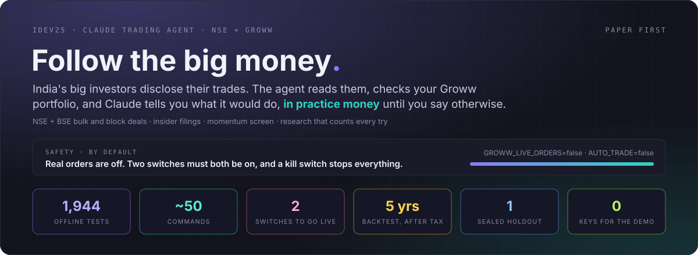
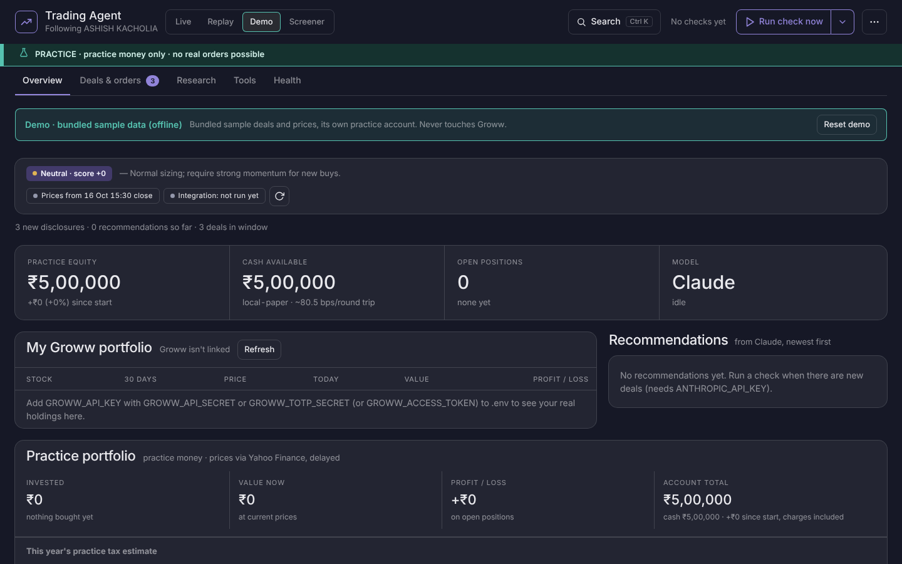
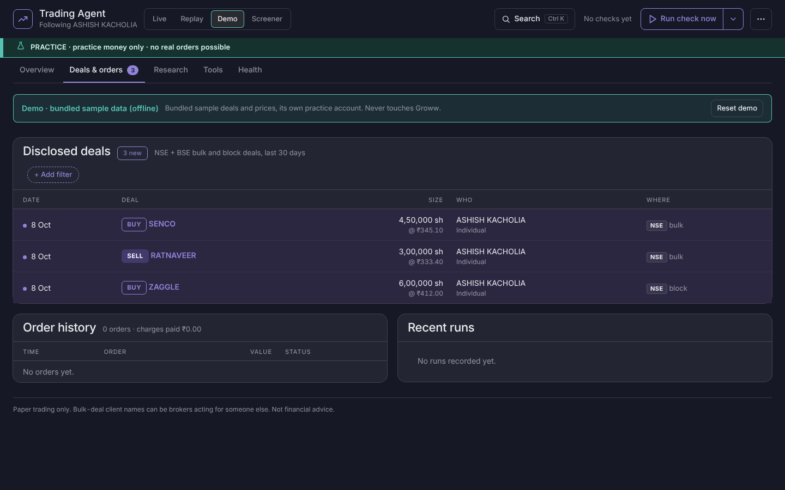
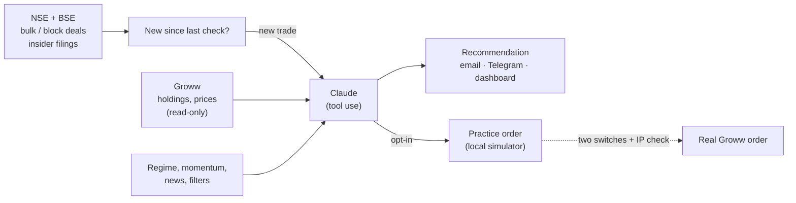
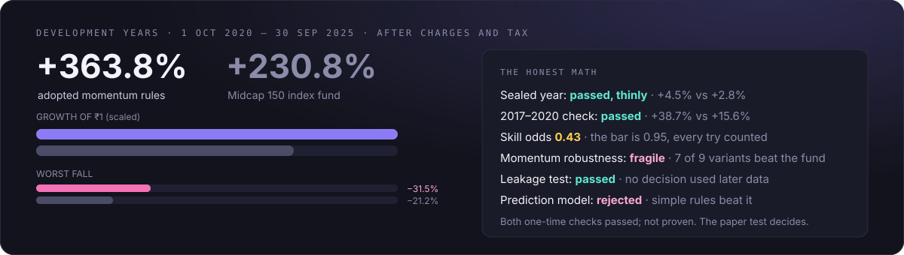

<p align="center">
  
</p>

<p align="center">
  <a href="#quick-start">Quick start</a> ·
  <a href="#what-it-does">What it does</a> ·
  <a href="#safety">Safety</a> ·
  <a href="#research-that-counts-every-try">Research</a> ·
  <a href="docs/guide.md">Full guide</a> ·
  <a href="docs/runbook.md">Runbook</a>
</p>

---

## 📈 Follow the big money, in practice money first

India's well-known investors have to disclose their large trades. **idev25** reads those disclosures from NSE and BSE
every few minutes, compares them with what you hold on **Groww**, and asks **Claude** what it would do: buy, hold or
leave alone, with its reasons. You get the answer by email, Telegram or the dashboard. It trades **practice money**
until you deliberately switch real orders on.

<p align="center">
  
</p>

## What it does

| | |
|---|---|
| 🔎 **Watches the disclosures** | NSE and BSE bulk and block deals, SEBI insider filings and company announcements for the investors you follow (`INVESTORS` in `.env`, up to 10). New ones are flagged within minutes during market hours. |
| 🤝 **Knows your portfolio** | Reads your real Groww holdings, read-only, and prices them live. Outside market hours it uses the saved close snapshot, so Groww is not called needlessly. |
| 🧠 **Asks Claude** | Claude gets the deal, your holdings, the market regime, momentum and the news, then recommends, with the checks that blocked or allowed it. Headlines are data, never instructions. |
| 🧪 **Trades practice money** | A local simulator seeded with your real holdings, Indian delivery charges and tax included. A separate account tests the prediction model on its own. |
| 📬 **Tells you** | Daily emails as readable cards, instant alerts for new deals and filings, and Telegram commands (`/lookup`, `/chart`, `/portfolio`, `/halt` …) from your own chat only. |
| ⏪ **Replays the past** | Start a practice portfolio on any date since 2021 and race the agent's rules and the index fund, with no peeking at later data. |
| 📊 **Researches honestly** | A daily portfolio simulator, a momentum screen, a signal lab, leakage and capacity checks, and a sealed holdout. Every variant tried is logged and counted against the result. |

<p align="center">
  
</p>

## Quick start

```bash
pip install -r requirements.txt
cp .env.example .env                                   # keys are optional for the first two steps

python -m trading_agent check --demo --dry-run         # 1. the whole pipeline on bundled sample deals, no keys, no calls
python -m trading_agent ui --demo                      # 2. the dashboard on the same sample data → http://127.0.0.1:8787
python -m trading_agent check --investor "ASHISH KACHOLIA"   # 3. real NSE data (add ANTHROPIC_API_KEY for Claude)
python -m trading_agent loop --every 30                # 4. keep checking every 30 minutes
```

Linking Groww, the server setup and every setting are in the [full guide](docs/guide.md#linking-groww) and the
[runbook](docs/runbook.md).

## How it works



## Safety

- **Real orders are off by default.** Both `AUTO_TRADE=true` and `GROWW_LIVE_ORDERS=true` must be set by hand in
  `.env`. The dashboard can never switch them on.
- **One gate for every real order.** It checks the kill switch (`kill-switch`, the dashboard button or `/halt`), both
  switches and Groww's registered IP. Each order carries a reference ID, so a retry can't place it twice.
- **Filters on every buy:** surveillance lists (ASM/GSM), results blackouts, price bands, an opening collar, a daily
  loss brake, and holdings you mark "never sell".
- **Telegram obeys only your private chat.** Its buy and sell commands are practice-only, with Confirm and Cancel.
- **Secrets stay local.** `.env` and `state/` are git-ignored, and tests can't reach any real service.

## Research that counts every try

<p align="center">
  
</p>

Backtests are easy to fool, so this one is built to catch itself:

- **Every variant ever tried is logged.** The deflated "skill odds" count all of them, and adding variants makes the
  bar harder to clear.
- **Overfitting checks:** the probability of backtest overfitting, purged cross-validation, and t-values adjusted for
  overlapping trades.
- **A leakage test** re-makes every decision with all later data removed. Every research command runs it first and
  stops on a leak.
- **Point-in-time index members, real Indian charges and tax.** Stocks with no price history are counted and named,
  not silently dropped.
- **Pass rules are written before the data is seen.** The four ideas left over from the research were
  [pre-registered](docs/research/preregistered-batch-2026-10-16.md) and are judged once, on 2017–2020 data no
  research has used. A sealed year (from Oct 2025) is opened once, for the adopted rules only.

Results and how to run each study are in the [full guide](docs/guide.md#keeping-score).

## Guide

| Topic | |
|---|---|
| The dashboard, Replay and Demo | [guide](docs/guide.md#the-dashboard) |
| Linking Groww | [guide](docs/guide.md#linking-groww) |
| Which investors you can follow | [guide](docs/guide.md#which-investors-can-i-follow) |
| Announcements, news and watch mode | [guide](docs/guide.md#global-context-announcements-and-watch-mode) |
| Daily emails | [guide](docs/guide.md#daily-emails) |
| Keeping score, the forward test, the signal lab | [guide](docs/guide.md#keeping-score) |
| Configuration (`.env`) | [guide](docs/guide.md#configuration-env) |
| Running it on a server | [runbook](docs/runbook.md) · [hosting](docs/hosting.md) |
| Development and tests | [guide](docs/guide.md#development) |

## Development

```bash
pip install -r requirements.txt
python -m pytest -q -n auto      # 1,944 offline tests: fake broker, fake NSE, fake Groww, a scripted Claude
ruff check trading_agent tests && mypy trading_agent
```

CI runs the tests on Python 3.12 and 3.15, lint, types and both demo runs on every push.

---

<sub>Practice money by default. Bulk-deal client names can be brokers acting for someone else. Past results, including
every number above, do not predict future returns. Not financial advice.</sub>
